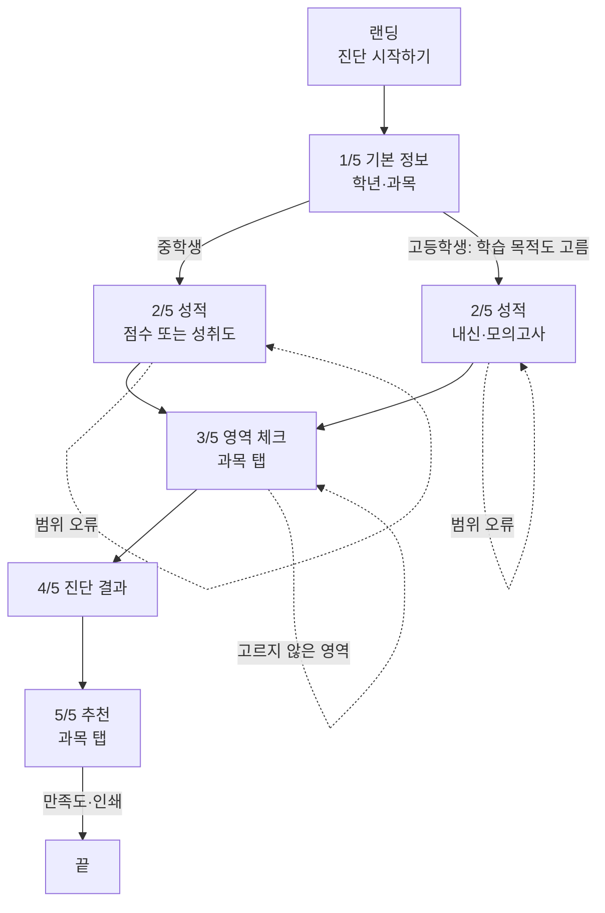

# 스토리보드·플로우 (1-A)

| 항목 | 내용 |
|------|------|
| 문서 상태 | 초안 (v0.1) |
| 근거 | [design-spec.md](./design-spec.md), [data-format.md](../data-format.md), README "추천 기준", PRD 5장(P0) |
| 프로토타입 | [`design/prototype/index.html`](../../design/prototype/index.html) — **한 번에 한 화면씩** 넘어가는 클릭형 |
| 디자인 검토용 보드 | [`design/mockups/index.html`](../../design/mockups/index.html) — 모든 화면을 한 페이지에 나란히 놓은 비교용 (실제 흐름 아님) |
| 단계별 스크린샷 | [`design/screenshots/flow/`](../../design/screenshots/flow/) |

> 사용자 피드백(2026-11-10): "한 화면에 전부 다 있으면 안 됩니다. 스토리보드·플로우를 단계별로 생각해서 다시 플로우 화면을 개발." → 이 문서로 흐름을 먼저 정하고, 프로토타입은 이 문서를 그대로 따릅니다.

## 1. 전체 흐름

- 화면은 **한 번에 하나만** 보입니다. 위쪽 띠에 "뒤로", 단계(1/5~5/5), 진행 막대가 있습니다. 랜딩은 단계에 넣지 않습니다.
- 브라우저의 뒤로 가기 버튼도 한 단계 뒤로 갑니다. 주소에는 단계 이름만 들어갑니다 (예: `#/grades`). **성적은 주소에 넣지 않습니다.**
- 입력값은 브라우저 메모리에만 둡니다. **새로고침하거나 탭을 닫으면 처음부터** 다시 합니다 (PRD 9장: 브라우저 저장소에도 기본으로 저장하지 않음).
- 화면이 바뀌면 키보드 초점이 그 화면의 제목으로 옮겨 갑니다 (화면 읽기 프로그램이 새 화면을 알 수 있게).

## 2. 화면별 스토리보드

### L. 랜딩 (`design/mockups/landing.html`)
| 항목 | 내용 |
|------|------|
| 목적 | 무엇을 해 주는지 알리고 진단을 시작하게 함 |
| 보이는 요소 | 제목·설명, 진단 시작하기, 걸리는 시간·개인정보·지원 범위, 3단계 흐름, 결과로 받는 것, 개인정보·광고 없음 안내 |
| 사용자 행동 | "진단 시작하기" |
| 다음 | 1/5 기본 정보 |
| 뒤로 | 없음 |
| 썸네일 | `flow/01-landing-360.png` |

### 1/5 기본 정보 (`#/info`)
| 항목 | 내용 |
|------|------|
| 목적 | 학년에 맞는 성적 입력 방식과 영역 목록을 정하기 위해 학년·과목을 받음 |
| 보이는 요소 | 학년 6개(중1~고3) 중 하나, 과목 3개(국·영·수) 중 하나 이상. **고등학생을 고르면** "지금 준비하는 시험"(내신 대비 / 수능 대비 / 둘 다)이 나타남. **고를 과목(코스)이 여럿인 과목은** "(과목): 지금 배우는 과목"(중학생은 "배운 범위": 1학기·2학기)이 나타남 — 공통·일반 선택·수능 대비는 펼쳐 두고, 진로·융합 선택은 "○개 더 보기"로 접어 둠(고른 것이 있으면 펼침). 목록은 `data/curriculum.json` |
| 사용자 행동 | 고른 뒤 "다음" |
| 검증·오류 | 학년 없음 → "학년을 골라 주세요." / 과목 없음 → "과목을 하나 이상 골라 주세요." / 고등학생인데 목적 없음 → "지금 준비하는 시험을 골라 주세요." / 과목(코스)을 안 고름 → "수학에서 지금 배우는 과목을 하나 이상 골라 주세요." (중학생: "배운 범위를…") 오류가 있으면 넘어가지 않고 첫 오류로 초점 이동 |
| 다음 | 2/5 성적 |
| 뒤로 | 랜딩 |
| 바뀌는 것 | 학년을 바꾸면 그 뒤 화면의 입력값(고른 과목(코스)·성적·영역 체크)을 비움 (학년마다 입력 방식·과목·단원이 다르기 때문) |
| 썸네일 | 고3 과목 고르기 `v2/10-h3-courses-360.png`, 고1 `v2/12-h1-info-360.png` (예전: `flow/02-info-high-360.png`, `flow/m02-info-middle-360.png`) |

### 2/5 성적 (`#/grades`)
| 항목 | 중학생 | 고등학생 |
|------|--------|----------|
| 보이는 요소 | 과목마다: "점수 / 성취도" 고르기 → 점수(0~100 정수) 칸 또는 성취도(A~E) 버튼 | 과목마다: 내신 등급(고1·고2는 1~5, 고3은 1~9), 모의고사 등급(1~9). 둘 중 하나 이상 |
| 안내 | "0부터 100까지 정수로 적어 주세요." | "내신과 모의고사 중 아는 것만 적어도 돼요." + 학년별 등급제 안내 |
| 검증·오류 | 비어 있음 → "성적을 적어 주세요." / 범위 밖·정수 아님 → "0부터 100까지 정수로 적어 주세요. 지금 적은 값: ○" | 둘 다 비어 있음 → "내신이나 모의고사 중 하나는 적어 주세요." / 범위 밖 → "○○ 등급은 1부터 ○까지 적을 수 있어요. 지금 적은 값: ○" |
| 다음 / 뒤로 | 3/5 영역 체크 / 1/5 | 같음 |
| 썸네일 | `flow/m03-grades-middle-360.png` | `flow/03-grades-high-360.png`, 오류 `flow/03b-grades-error-360.png` |

### 3/5 영역 체크 (`#/areas`)
| 항목 | 내용 |
|------|------|
| 목적 | 과목마다 약한 영역을 스스로 표시 |
| 보이는 요소 | 과목이 둘 이상이면 **과목 탭**(사용자 결정: 과목 탭 유지). 탭 안에 **1단계에서 고른 과목(코스)마다 제목**(예: 수학Ⅰ, 미적분)을 두고 그 아래 단원마다 자신 있음 / 보통 / 약함. 교육과정 표시. 체크를 다 마친 과목 탭에 ✓. 단원이 없는 과목은 "(과목) 전체" 한 칸 |
| 사용자 행동 | 단원마다 하나씩 고르고 "다음" |
| 검증·오류 | 고르지 않은 단원이 있으면 "아직 고르지 않은 영역이 ○개 있어요: 삼각함수 (수학Ⅰ), …" + 그 과목 탭으로 이동, 첫 단원으로 초점 |
| 다음 / 뒤로 | 4/5 결과 / 2/5 |
| 접기를 안 쓴 이유 | 단원을 접어 두면 오류가 났을 때 접힌 칸으로 초점을 옮길 수 없어서, 3단계는 접지 않고 과목 제목으로만 묶음. 단원은 대단원 단위(과목당 2~6개)라 휴대폰에서도 길지 않음 |
| 썸네일 | 고3 수학 `v2/11-h3-areas-math-360.png`, 중2 `v2/13-m2-areas-360.png` |

### 4/5 진단 결과 (`#/result`)
| 항목 | 내용 |
|------|------|
| 목적 | 과목별 수준과 그 근거, 먼저 볼 영역을 보여 줌 |
| 보이는 요소 | 과목마다 수준 상자(상/중/하) + 근거 문장, 먼저 볼 영역(약함 → 보통 순), 임시 기준·자가 체크 안내 |
| 예외: 모두 자신 있음 | 그 과목은 "먼저 볼 영역" 대신 "모든 영역에 자신 있다고 했어요…" 안내 + 과목 전체 추천 묶음 예고 |
| 사용자 행동 | "추천 보기" |
| 다음 / 뒤로 | 5/5 추천 / 3/5 |
| 썸네일 | `flow/05-result-360.png` (고3: 영어는 보통 결과, 수학은 모두 자신 있음 예외), `flow/m05-result-middle-360.png` (중2) |

### 5/5 추천 (`#/recommend`)
| 항목 | 내용 |
|------|------|
| 목적 | 약하거나 보통인 영역마다 강의·책 추천 |
| 보이는 요소 | 과목 탭, "EBS 공식 채널의 무료 강의와 EBS 교재 중에서, 사람이 확인하고 승인한 것만…" 안내, 영역마다 추천 방향 + **"영상 강의"(h4) 큰 소제목 → 강의 1~2**(재생목록 우선, 무료, 길이·강의 수, 추천 이유, 확인한 날) + "EBSi에서 이 과목 강좌 찾기" 링크, **"책"(h4) 큰 소제목 → 책 1~2**, 새 탭에서 보기, 숨기기(P1), 만족도, 결과 인쇄하기(P1). 승인된 항목만 (`/api/recs`), 표지·썸네일은 서버 경유 (docs/api-decision.md) |
| 빈 상태 | 승인된 항목이 없으면 묶음마다 "확인을 마친 무료 강의를 준비하고 있어요." / "확인을 마친 책을 준비하고 있어요." (`v2/05c-recommend-groups-360.png`) |
| 내부 확인 페이지 | `/admin/review.html` (학생 화면과 연결 안 됨): 후보 찾기 → 리뷰어 확인 → 사용자 승인 (`v2/14-admin-review-1024.png`) |
| 예외: 모두 자신 있음 | 영역별 칸 대신 "(과목) 전체" 한 칸 |
| 사용자 행동 | 링크 열기, 숨기기·다시 보기, 만족도 예/아니요(한 번만), 인쇄 |
| 다음 / 뒤로 | 끝 / 4/5. "처음부터 다시 하기"로 1/5 |
| 썸네일 | `flow/06-recommend-360.png`, 숨기기·만족도 `flow/06b-recommend-math-hidden-360.png`, 중2 `flow/m06-recommend-middle-360.png` |

## 3. 분기와 예외 정리
| 경우 | 처리 |
|------|------|
| 중학생 | 학습 목적 질문 없음. 성적은 점수(정수) 또는 성취도. 수준: 90 이상 상, 70~89 중, 69 이하 하 / A 상, B·C 중, D·E 하 |
| 고등학생 | 학습 목적 질문. 내신은 고1·고2 5등급제, 고3 9등급제. 모의고사 9등급제. 둘 다 적으면 내신 대비 → 내신, 수능 대비 → 모의고사, 둘 다 → 낮은 쪽 수준. 하나만 적으면 그 성적 |
| 과목 여러 개 | 성적은 한 화면에 과목별 묶음, 영역 체크·추천은 과목 탭 (화면 자체는 하나) |
| 모든 영역 자신 있음 | 결과·추천에서 과목 전체 한 묶음 (data-format 6절 4번) |
| 추천 준비 중 | 빈 상태 문구, 빈 화면 없음 |
| 중간에 나갔다 돌아오기 | 뒤로 가기·앞으로 가기는 같은 탭에서 유지. 새로고침·탭 닫기 → 처음(1/5)부터, "새로고침하면 처음부터 다시 시작해요. 입력한 성적은 저장하지 않아요." 안내 |
| 앞 단계를 건너뛴 주소로 바로 들어옴 | 필요한 입력이 없으면 1/5로 보냄 |

## 4. 결정 기록
- 저장: **메모리만** (sessionStorage도 쓰지 않음). PRD 9장 "브라우저 저장소에도 기본으로 저장하지 않음"을 따름. 그 대가로 새로고침하면 처음부터.
- 주소: 단계 이름만 해시에 넣음 (`#/info` 등). 성적·수준·체크 결과는 넣지 않음.
- 분석 이벤트: 프로토타입에는 넣지 않음 (Umami 연결은 1-B).
- ~~수학 영역 이름은 예시 단원~~ → 2026-11-11부터 `data/curriculum.json`의 교육과정 기준 과목·단원 (출처·[확인 필요]는 data-format.md 3-1절).
- 추천 검색어: 고등학생은 과목(코스) 이름 + 단원 (예: "고3 수학Ⅰ 삼각함수 개념 정리", 책 "고등 수학Ⅰ 삼각함수" → 없으면 "고등 수학Ⅰ"). 중학생은 "중2 수학 일차함수 …". 성적·체크 결과는 넣지 않음.
- 추천 항목은 모두 **가상**입니다.

## 5. Playwright로 확인한 경로 (2026-11-10)
| 경로 | 확인한 것 |
|------|-----------|
| 고3, 영어·수학, 둘 다 | 랜딩 → 1~5단계 끝까지 클릭. 화면마다 하나만 보이고 초점이 제목으로 감. 영어: 모의 4(중)·내신 2(상) → 중, 독해 약함 = 개념 정리 강의 + 유형별 문제집, 듣기 = 준비 중. 수학: 모두 자신 있음 → 과목 전체 묶음 |
| 1단계 오류 | 아무것도 안 고르고 다음 → 학년·과목 오류 2개, 초점이 학년으로 |
| 2단계 오류 | 수학 모의고사 12 → "1부터 9까지…지금 적은 값: 12", aria-invalid, 초점이 그 칸으로, 넘어가지 않음 |
| 3단계 빠진 영역 | 영어만 고르고 다음 → "아직 고르지 않은 영역이 4개…", 수학 탭으로 자동 전환, 첫 빠진 영역으로 초점. 다 고른 과목 탭에 ✓ |
| 5단계 | 방향키(→)로 과목 탭 이동, 숨기기 → 1개만 보이고 "다시 보기"로 초점, 만족도 한 번만 |
| 뒤로 가기 | 브라우저 뒤로 → 4단계, 화면 "뒤로" → 3단계, 체크 8개 그대로 |
| 새로고침·건너뛴 주소 | `#/areas`로 바로 열기 → 1단계 + "새로고침하면 처음부터…" 안내 |
| 중2, 국어·수학 | 학습 목적 질문 없음, 국어 성취도 B → 중, 수학 89.5 → 정수 오류, 68 → 하, 일차함수 약함 = 개념 기초 강의 + 쉬운 개념서 |
| 움직임 줄이기 | 고1 경로에서 화면 전환·진행 막대·약함 칠하기 모두 움직임 0개, 노랑은 바로 다 칠해짐, 진행은 정상 |
| 고친 뒤 오류 정리 (리뷰 반영) | 1단계: 학년을 고르면 학년 오류만 사라지고 과목 오류는 남음, 과목을 고르면 그것도 사라짐(초점은 고른 칸에 남음). 2단계: 89.5 오류 뒤 68 입력 → 오류 문장·빨간 테두리·aria-invalid·aria-describedby가 바로 없어지고 초점은 그 칸에. 3단계: 위쪽 알림이 영역을 고를 때마다 줄어들고(4개→3개) 다 고르면 사라짐 |
| 화면 뒤로 + 브라우저 뒤로 (리뷰 반영) | 3단계에서 화면 "뒤로" → 2단계, 이어서 브라우저 뒤로 → 1단계 (앞쪽 3단계로 가지 않음) |
